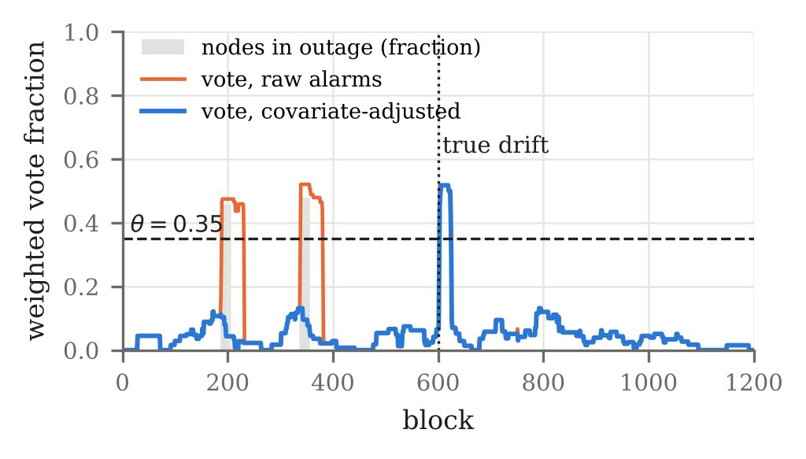
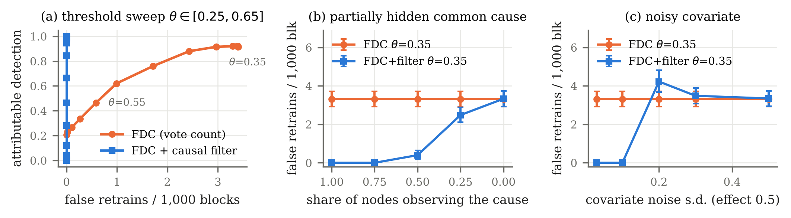

# NeuroStream

**Common-Cause-Aware Federated Drift Consensus with Anytime False-Alarm Control**

Code, seeded experiments and result logs for the paper
*"NeuroStream: Common-Cause-Aware Federated Drift Consensus with Anytime False-Alarm Control"*
by A. Jamshaid, M. Z. Hasan, M. Z. Hussain and A. Hussain.


> Every number, table and figure in the paper is regenerated from this repository by seeded scripts.

---

## The problem in one picture

In federated edge analytics, many nodes (sensors, gateways, devices) each watch their own data stream. A coordinator
starts a costly, coordinated **retraining** when enough nodes raise a drift alarm. This fails when many nodes alarm for
the **same external reason**, for example a regional power sag, an uplink outage or a maintenance window. Counting
alarms cannot tell that apart from a genuine regional drift.



*Orange: plain weighted voting crosses the threshold during both outages (two false federation-wide retrains).
Blue: NeuroStream's covariate-adjusted vote stays quiet during the outages and crosses the threshold only at the true
drift (block 600).*

## What NeuroStream does

1. **Common-cause filter.** Each node compares two sliding windows of its data. It also repeats the comparison after
   regressing out an *observed* common-cause covariate (for example supply voltage). A node votes only if its alarm
   survives that adjustment.
2. **Reliability-weighted consensus.** The coordinator sums the weights of the voting nodes. If the weighted share
   reaches the threshold, it triggers a **global** retrain. If a single node's alarm persists, it triggers a **local**
   retrain. Otherwise it does nothing and logs the suppressed alarm.
3. **Anytime-valid detector.** A Shiryaev–Roberts e-detector on the vote fractions gives an average-run-length
   (false-alarm) bound that holds at every time, not just at a fixed horizon.
4. **Privacy and robustness.** Votes can be released with a Sparse-Vector mechanism. The privacy accounting charges
   every data-dependent release. Robust aggregators (median, trimmed mean, Krum, centered clipping, FLTrust) are tested
   against adaptive attacks.

### Theory contributions (proved in the paper)

- A per-window false-alarm bound in the **effective federation size** `K_eff = (Σα)² / Σα²`.
- An **impossibility result**: if a common cause makes nodes holding more than a fraction θ of the vote weight alarm,
  the false-retrain probability tends to the probability of the cause, whatever K and θ are.
- An **anytime-valid ARL guarantee** that holds for covariate-adjusted votes and provably fails for raw votes.

## Headline results

| Setting | Result |
|---|---|
| Controlled simulation (200 seeds) | Plain weighted voting: **3.41** false federation-wide retrains per 1,000 blocks. With the filter: **0** (95% upper bound 0.026). Attributable drift detection 0.990 (plain voting 0.915). |
| Three public streams with injected outages (Elec2, Covertype, Airlines) | The filter reduces outage-induced false retrains in **8 of 8** configurations. |
| NASA C-MAPSS (real recorded operating condition, FD002) | Degradation detection rises from **0.008** to **0.935** when conditioning on the operating condition. |
| Privacy | With Sparse-Vector voting at ε_svt = 0.2 the filter's results are kept. Fewer false retrains make a node's privacy budget last **3.3×** longer. |

Scope: outages and drifts in the stream experiments are **injected** and labelled as such. No hardware, latency, energy
or language-model results are claimed.



## Quick start

```bash
git clone https://github.com/yourusername/repository-name.git
cd repository-name

python -m venv .venv && source .venv/bin/activate     # Windows: .venv\Scripts\activate
pip install -r requirements.txt                       # Python 3.13; exact versions used for all results

python data/fetch_data.py       # downloads the four public datasets and checks SHA-256 (about 140 MB)
make all                        # regenerates every result, table, figure and the PDF
```

Try the simulator in a few seconds, with no dataset download:

```python
from ns import sim

runs = [sim.run_seed(sim.DEFAULT, seed, thetas=(0.35,)) for seed in range(20)]
for m in ["FDC@0.35", "FDC+filter@0.35"]:
    fa  = sum(r["methods"][m]["false_episodes"] for r in runs)
    det = sum(r["methods"][m]["detected"] for r in runs)
    print(f"{m:18s} false retrains: {fa:3d}   drift detected in {det}/20 seeds")
```

`python exps/v_verify.py` recomputes 23 headline numbers from the per-seed logs in `results/` without re-running any
experiment, and reports any mismatch with `paper/numbers.tex`.

## Repository layout

```
ns/            library
  sim.py         Track S: controlled simulator, window test, covariate adjustment, Sparse-Vector gate, e-detector
  stream.py      Track A: real streams with injected outages/drift, open-loop and closed-loop evaluation
  fl.py          federated softmax regression, DP local updates, robust aggregators, Byzantine attacks
  accounting.py  Rényi/zCDP privacy accounting
  data.py        dataset loading (SHA-256 checked), preprocessing without look-ahead, non-IID partitioning
  stats.py       Wilson / bootstrap / Poisson confidence intervals
  runner.py      seeded parallel experiment runner that writes per-seed JSON logs
exps/          one script per experiment (table below); legacy/ = earlier manuscript's scripts (Fig. 2a only)
data/          fetch_data.py, SHA256SUMS.mirror, PROVENANCE.md (datasets are downloaded, never committed)
results/       per-seed JSON logs with config hash, seeds, runtime and library versions
figs/          figures as PDF and PNG
paper/         LaTeX source; numbers.tex and tables/ are generated from results/
docs/          CLAIMS_TABLE.md (every number -> result file -> producing script), CODE_GUIDE.md (this code explained)
```

New to the code? Read **[docs/CODE_GUIDE.md](docs/CODE_GUIDE.md)** for a walkthrough of every module.

## What each command regenerates

| Make target | Scripts | Output | Time on 2 vCPUs |
|---|---|---|---|
| `make fetch` | `data/fetch_data.py` | `data/raw/` | download only |
| `make data` | `exps/d0_provenance.py` | `results/data_provenance.json`, `data/PROVENANCE.md` | < 1 min |
| `make sim` | `exps/s1_main.py`, `exps/s2_sweeps.py` | `results/S*/` | about 5 min |
| `make real` | `exps/a1_open_loop.py`, `exps/a2_closed_loop.py`, `exps/c1_cmapss.py` | `results/A/`, `results/B_real/` | about 1 h |
| `make privacy` | `exps/p1_accounting.py`, `exps/p2_b1_fl.py p2` | `results/P/` | about 30 min |
| `make robust` | `exps/p2_b1_fl.py b1` | `results/B/` | about 15 min |
| `make theory` | `exps/t1_theory.py` | `results/T/` | about 1 min |
| `make paper` | `exps/f_figures.py`, `exps/f_numbers.py`, LaTeX | `figs/`, `paper/numbers.tex`, `paper/tables/`, `paper/main.pdf` | < 1 min |

All randomness is seeded (`numpy.random.SeedSequence`, one stream per event type). `make paper` needs a LaTeX
installation with `pdflatex` and `bibtex`.

## Experiments at a glance

- **Track S (simulation).** 50 nodes, 1,200 blocks, known ground truth. Paired runs with and without the genuine drift
  make "attributable detection" exact. Includes threshold tuning on separate validation seeds, sweeps over federation
  size, affected fraction and drift magnitude, covariate failure modes (hidden, noisy, non-linear, spoofed),
  Byzantine voters, and the private Sparse-Vector gate.
- **Track A (real streams).** Elec2, Covertype and Airlines split across K nodes. Outages and regional drift are
  injected with labels. The open loop freezes the model and measures decision quality. The closed loop retrains and
  measures prequential accuracy against static, periodic, oracle, local ADWIN and a FedDrift re-implementation.
- **Track B (C-MAPSS).** NASA turbofan data with a real recorded common cause (the operating condition). Node-level
  test only.
- **Privacy and robustness.** DP utility versus noise, privacy accounting checked against Google's `dp_accounting`,
  and seven aggregators under four attacks (sign-flip, ALIE, inner-product manipulation, min-max).

## Data

All four datasets are public and are not redistributed here. `data/fetch_data.py` downloads the exact files used in the
paper from GitHub mirrors at pinned commits and stops if any checksum differs.

| Dataset | Official source | File used | Licence (official page) |
|---|---|---|---|
| Elec2 | [OpenML 151](https://www.openml.org/d/151) | `elec.csv`, 45,312 rows | not stated |
| Covertype | [UCI ML Repository](https://doi.org/10.24432/C50K5N) | `covtype.csv`, 581,012 rows | CC BY 4.0 |
| Airlines | [OpenML 1169](https://www.openml.org/d/1169) | `airlines.csv`, 539,383 rows | not stated |
| NASA C-MAPSS | [NASA Open Data Portal](https://data.nasa.gov/dataset/cmapss-jet-engine-simulated-data) | 12 text files (FD001 to FD004) | not specified |

Mirrors used: [scikit-multiflow/streaming-datasets](https://github.com/scikit-multiflow/streaming-datasets) at commit
`f1eb9f0` and [edwardzjl/CMAPSSData](https://github.com/edwardzjl/CMAPSSData) at commit `ed40e40`. To use another copy,
put the files in a folder and set `NS_DATA` to it; the loaders check the same SHA-256 hashes.

No dataset is resampled, extended or synthesised.

## What is and is not claimed

- Track S is a simulation with known ground truth. In Track A the outages and drifts are injected into public streams
  and their covariate is synthetic. Track B (C-MAPSS) uses a real recorded covariate, at node level.
- The filter needs an **observed** common-cause covariate. The paper maps its failure modes (hidden, noisy or spoofed
  covariates, vote flooding).
- No hardware, latency, energy or language-model results are claimed.

## Superseded runs kept for transparency

These result files are kept so that every run reported during development can be inspected. None is used in the paper.

| File | Why it was superseded | Replaced by |
|---|---|---|
| `results/A_grid025/` | Threshold grid started at 0.25; tuned thresholds hit the lower edge | `results/A/` (grid from 0.15) |
| `results/P/dp_utility_v1_confounded.json` | Non-private runs were unclipped while private runs were clipped with an untuned learning rate | `results/P/dp_utility.json` |
| `results/B/byzantine_area_partition.json` | Every aggregator stayed near the majority-class rate, so the test could not separate them | `results/B/byzantine.json` |
| `results/legacy/exp_b.json`, `exp_c.json`, `exp_d.json` | Outputs of the earlier manuscript's scripts | `results/P/`, `results/S/`, `results/B/` |

## Citation

If you use this code or these results, please cite the paper and this repository (see `CITATION.cff`).

```bibtex
@misc{neurostream2026,
  title  = {NeuroStream: Common-Cause-Aware Federated Drift Consensus with Anytime False-Alarm Control},
  author = {Jamshaid, Abdullah and Hasan, Muhammad Zulkifl and Hussain, Muhammad Zunnurain and Hussain, Aatif},
  year   = {2026},
  note   = {Code and data: https://github.com/yourusername/repository-name}
}
```

## Licence

The code and result files are released under the MIT License (`LICENSE`). The manuscript source in `paper/` is included
so that `make paper` can rebuild the PDF; its text remains the authors' work under review and is not covered by the MIT
License.

## Authors

- Abdullah Jamshaid, Institute of Data Science, University of Engineering & Technology, Lahore
- Muhammad Zulkifl Hasan, Department of Computer Science, University of Central Punjab
- Muhammad Zunnurain Hussain, Department of Computer Science, Bahria University
- Aatif Hussain, Institute of Data Science, University of Engineering & Technology, Lahore
